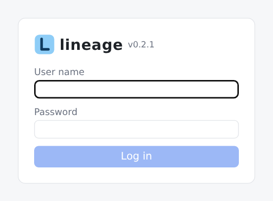
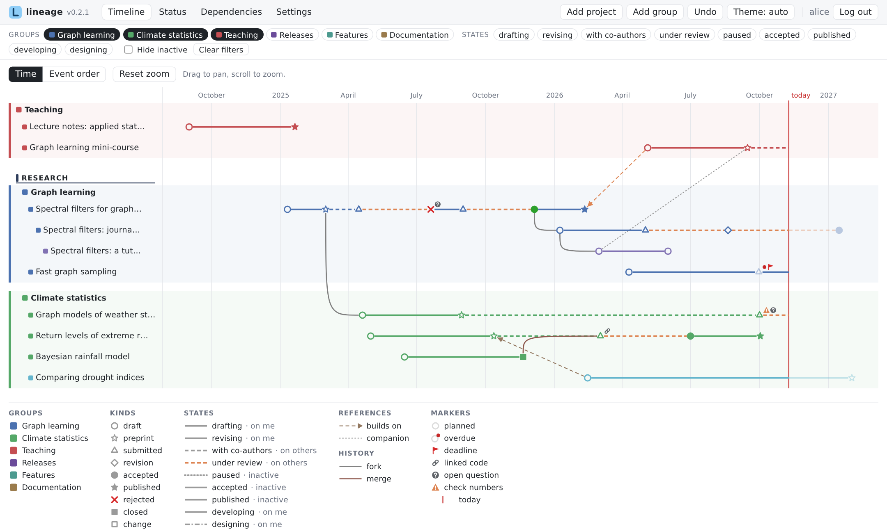
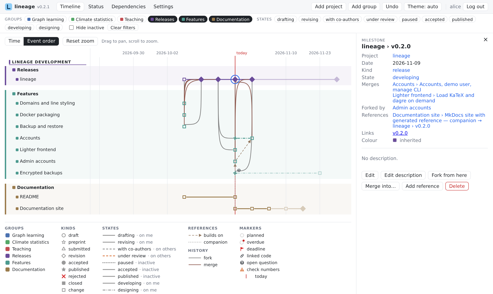
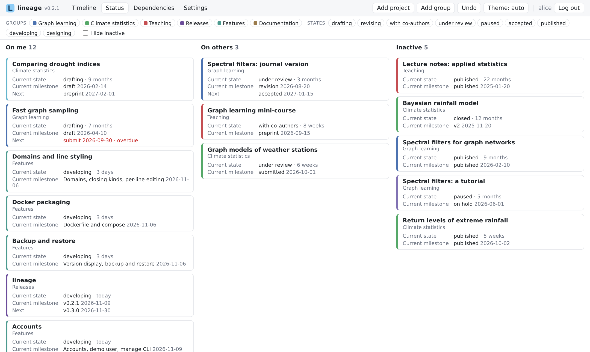

# Getting started

This walks you through running lineage and exploring the example data. It takes about ten minutes.

## 1. Run it

=== "Docker"

    Requirements: Docker with Compose.

    ```sh
    git clone https://github.com/gondoresearch/lineage.git && cd lineage
    mkdir data
    docker compose up -d
    ```

    Open <http://localhost:8080>. If your user id is not 1000 (`id -u`), see [Docker](hosting/docker.md#your-user) first.

=== "From source"

    Requirements: Python 3.12+, Node.js 22.12+, `make`.

    ```sh
    git clone https://github.com/gondoresearch/lineage.git && cd lineage
    make install
    make start DATA_DIR=/tmp/lineage-try
    ```

    Open <http://localhost:5173>. Stop it later with `make stop`.

## 2. Log in as the demo user

On its first start, lineage creates an account **demo** with password **demo**, whose workspace is a copy of the example data: a few fictional research papers, a teaching project, and lineage's own development history (the *lineage development* domain). Log in with it.

<figure markdown="span">
  [{ width="320" }](assets/screenshots/login.png)
  <figcaption>The login page.</figcaption>
</figure>

!!! note
    The demo account exists so you can look around. Before making lineage reachable from other machines, delete it or change its password — see [Accounts](hosting/accounts.md#the-demo-account).

## 3. Read the timeline

The **Timeline** shows one lane per project, in coloured groups. Along each lane:

- each **symbol** is a milestone; its shape is the milestone's *kind* (a triangle is "submitted", a full star "published", and so on — the legend lists them);
- the **line** between two milestones shows the *state* the project was in meanwhile: solid while you are drafting, dashed while it is under review, dotted while paused;
- a lane that starts from a milestone of another lane is a **fork**; a curve joining a lane into another is a **merge**;
- thin lines between milestones of different projects are **references** ("builds on", "companion").

<figure markdown="span">
  [](assets/screenshots/timeline.png)
  <figcaption>The timeline of the example research projects.</figcaption>
</figure>

Scroll to zoom, drag to pan, and switch the axis between **Time** and **Event order** (evenly spaced milestones, handy when many happen close together). Hover any milestone to highlight everything it descends from and everything that descends from it.

## 4. Change something

1. Click a milestone. The side panel shows it; press **Edit**, change its title, save. A toast confirms the change and offers **Undo**.
2. Press **Add project** in the toolbar, give it a title and group, and a first milestone.
3. Click a milestone of another project and use **Fork from here** to start a project from it, or **Merge into…** to merge a project into another. When lineage asks you to pick a milestone, click it on the timeline.
4. Add a reference from a milestone with **Add reference**, and pick its target on the timeline.

<figure markdown="span">
  [](assets/screenshots/panel-milestone.png)
  <figcaption>A selected milestone: the side panel shows it, with what it merges, forks and refers to, and the actions.</figcaption>
</figure>

Every change is checked against the whole workspace before it is saved; if something would become inconsistent, you get a message and nothing changes.

## 5. Look at the other views

- **Status** sorts projects into *On me*, *On others* and *Inactive*, by how long they have been in their current state.
- **Dependencies** draws projects as a graph, earlier work at the bottom.

<figure markdown="span">
  [](assets/screenshots/status.png)
  <figcaption>The status board: who each project is waiting on, and for how long.</figcaption>
</figure>
- **Settings** holds your vocabulary (kinds, states, reference types, markers, domains, groups), backup and restore, and your account.

## Next

- Learn the model properly in [Concepts](guide/concepts.md).
- Make your own account: [Accounts](hosting/accounts.md).
- Have a look at the files behind it: [Data format](reference/data-format.md).
