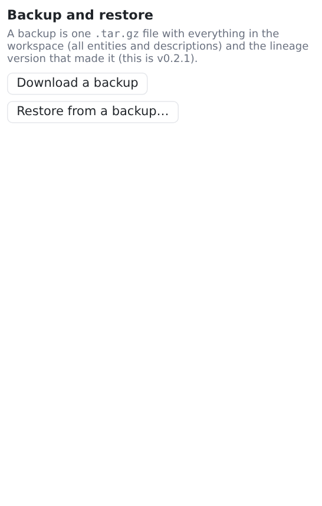

# Backup and restore

**Settings → Backup and restore** works on your own workspace only; other accounts are untouched. An [admin](../hosting/accounts.md#admin-accounts) can also back up and restore other users' workspaces, from **Settings → Users → Backup…**; those backups are named `lineage-backup-<user>-…`.

## Download a backup

**Download a backup** saves one file, `lineage-backup-<version>-<date>-<time>.tar.gz`. It contains:

- `workspace.yaml` and every description file;
- `lineage-backup.json`, a manifest with the lineage version and the date it was made.

The undo history (`.history/`) is not included.

<figure markdown="span">
  [{ width="420" }](../assets/screenshots/backup.png)
  <figcaption>Settings → Backup and restore.</figcaption>
</figure>

## Restore

**Restore from a backup…** replaces your whole workspace with the backup's contents, after you confirm.

- The file is checked first: it must be a lineage backup, with safe paths only and a valid workspace. Otherwise you get a message and nothing changes.
- If it was made by another lineage version, you are warned and asked again (**Restore anyway**).
- Your current data is snapshotted first, so **Undo** right after a restore brings it back.

A restore also repairs a workspace broken by a hand edit.

## Other ways to back up

The workspace is plain text: you can copy `data/users/<name>/` yourself, or keep it in git, where it diffs well. To back up the whole installation (all accounts), copy the entire data folder, including `accounts.yaml` and `.secret`.
