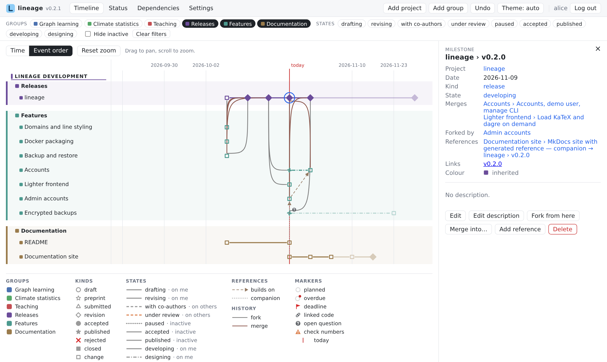
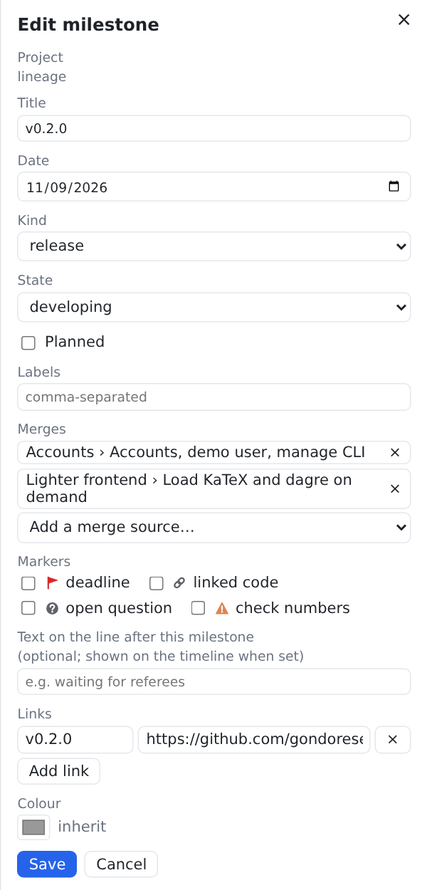
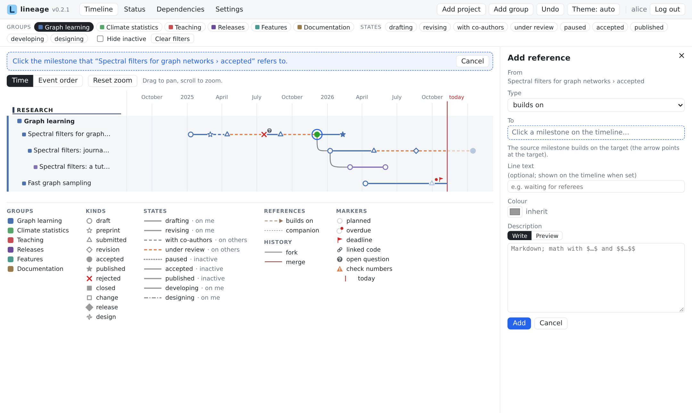
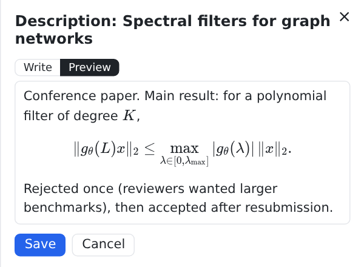
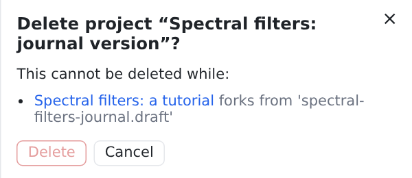

# Editing

Click anything on the timeline — a milestone, a lane, a reference, a lane label — and the **side panel** shows it, with its description and the actions that apply.

<figure markdown="span">
  
  <figcaption>The side panel of a release that merges two features.</figcaption>
</figure>

## Creating

- **Add project** (toolbar) creates a project together with its first milestone.
- **Add group** (toolbar) creates a group; domains, kinds, states, reference types and markers are created in **Settings**.
- **Add milestone** in a project's panel adds a milestone to it.

<figure markdown="span">
  [{ width="360" }](../assets/screenshots/edit-milestone.png)
  <figcaption>Editing a milestone: kind, state, planned, merges, markers, line text, links and colour.</figcaption>
</figure>

## Forks, merges and references

From a milestone's panel:

- **Fork from here** creates a new project starting at this milestone.
- **Merge into…** merges this project into another one: lineage asks you to pick the milestone on the timeline that does the merging.
- **Add reference** links this milestone to a milestone of another project; pick the target on the timeline, then its reference type.

While lineage waits for you to pick a milestone, it says what it is waiting for at the top of the timeline. Press **Esc** to cancel.

<figure markdown="span">
  
  <figcaption>Adding a reference: lineage waits for you to click the target milestone on the timeline.</figcaption>
</figure>

## Lane lines

Each lane line — the stretch after a milestone, until the next — can be selected on its own. It normally looks like its state, but you can give it its own pattern, colour, thickness, opacity and text (with position, alignment and size). Clear an override to go back to the state's look.

## Descriptions

**Edit description** opens a Markdown editor with **Write** and **Preview** tabs. Math is written as `$…$` inline and `$$…$$` for display. Links in descriptions open in a new tab.

<figure markdown="span">
  [{ width="360" }](../assets/screenshots/description.png)
  <figcaption>A description with display math, in the preview tab.</figcaption>
</figure>

## Deleting

**Delete** first shows what would happen: everything that would be removed with it (for example a project's milestones and their references), or what is **blocking** the delete (for example a state still in use). Nothing is deleted until you confirm.

<figure markdown="span">
  [{ width="360" }](../assets/screenshots/delete.png)
  <figcaption>Deleting a project that another project forks from is blocked, and lineage says why.</figcaption>
</figure>

## Undo

Every change can be undone: from the toast that confirms it, or with **Undo** in the toolbar, one step at a time, back through the last 20 changes. There is no redo. Undo also reverts a [restore](backup-restore.md).

## Validation

Every change is checked against the whole workspace before anything is written. If it would leave the workspace inconsistent (a milestone pointing at a project that no longer exists, a merge into the project itself, an invalid colour…), you get a message and the files stay as they were.

## Hand edits

You can also edit the files directly (see [Data format](../reference/data-format.md)). The page picks up the change within about 5 seconds, without losing your zoom, filters or open panel. If a hand edit leaves the workspace invalid, a red banner lists the problems until the file is fixed, and changes from the app are refused meanwhile.
