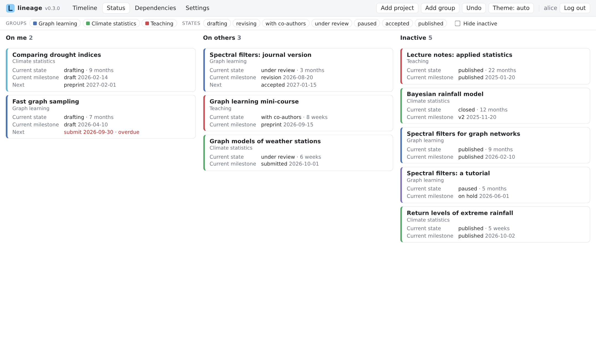
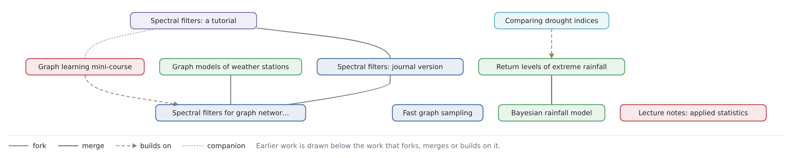

# Status board and dependencies

## Status board

The **Status** view answers "what is waiting on whom, and since when?". Projects are sorted into three columns by their current state's *waiting on*:

- **On me** — states such as drafting or revising;
- **On others** — states such as under review or with co-authors;
- **Inactive** — states waiting on nobody (paused, published…), and projects that are closed or have no state.

Within a column, projects are sorted by **time in state**: how long since their head milestone. Click a card to open the project in the side panel.

<figure markdown="span">
  
  <figcaption>The status board.</figcaption>
</figure>

## Dependencies view

The **Dependencies** view draws projects as a graph: an edge for every fork, merge and reference between two projects, with earlier work at the bottom and the work that builds on it above. It is useful to see what a project rests on, and what would be affected by it.

<figure markdown="span">
  
  <figcaption>The dependencies view of the papers example: earlier work at the bottom.</figcaption>
</figure>

Both views follow the [filters](timeline.md#filters) and the hover highlighting of the timeline.
