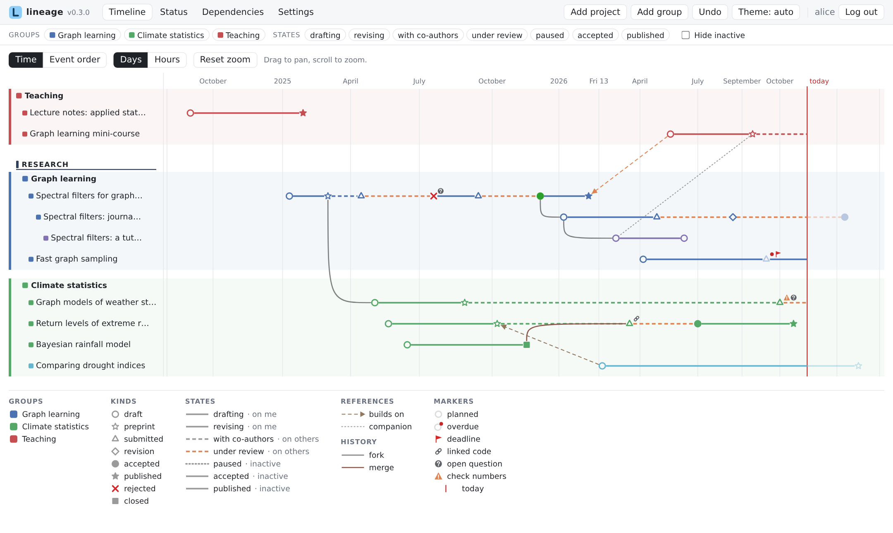
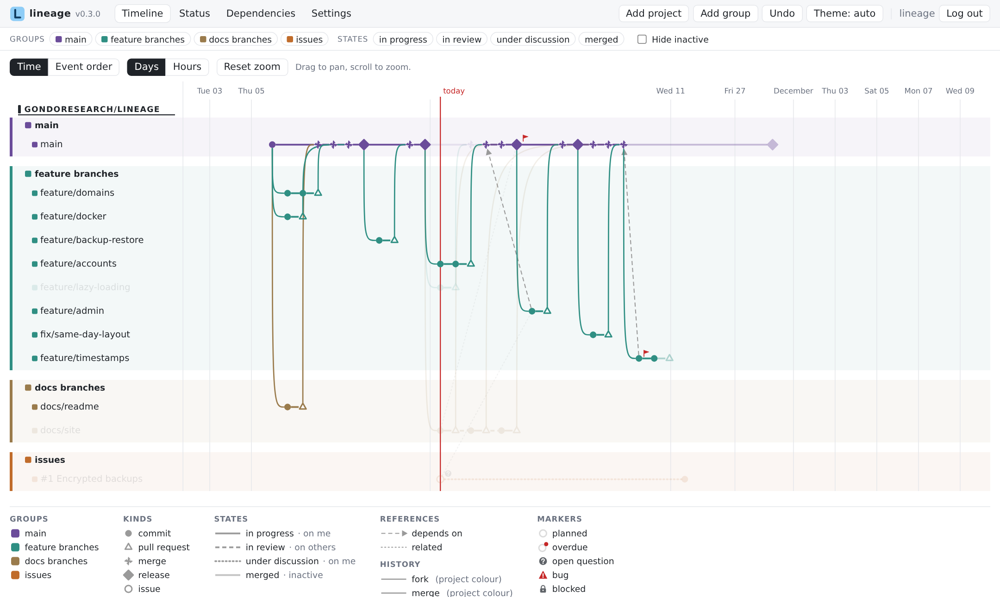
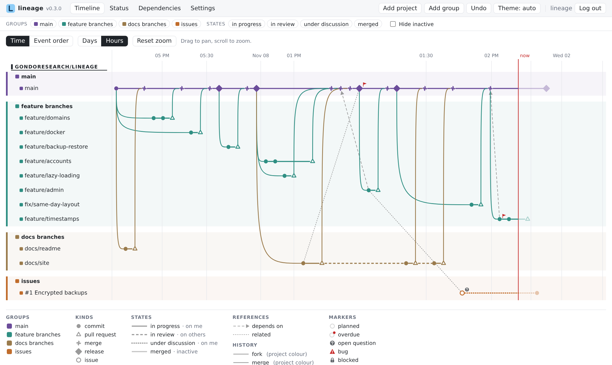
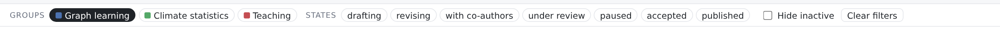
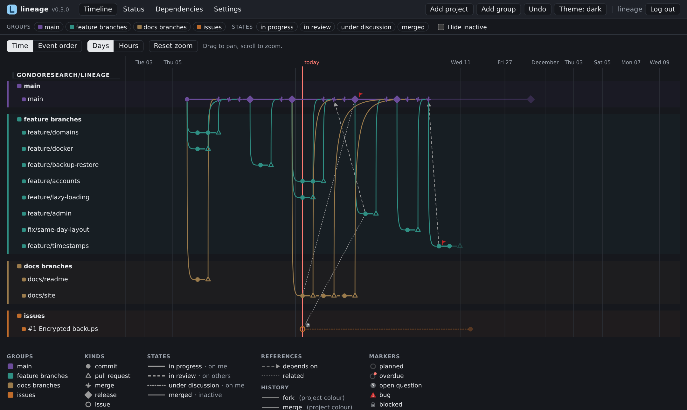

# The timeline

The timeline is the main view: one horizontal **lane** per project, grouped by group (and domain), with time running left to right.

## Reading it

- **Symbols** are milestones; the shape and size come from the milestone's kind. **Planned** milestones are drawn faded; a planned milestone whose date has passed gets an *overdue* dot. A vertical line marks today.
- **Lane lines** between milestones show the state the project was in: their pattern, colour, thickness and opacity come from the state, and any single line can override them (see [Editing](editing.md#lane-lines)).
- **Forks** are drawn under their origin, starting from the milestone they forked from. **Merges** curve into the milestone that merges them. Their colour and thickness are set in **Settings → Fork and merge lines**.
- **References** are thin lines between milestones of different projects, styled by their reference type; directed types have an arrow.
- **Markers** are small badges on milestones (warning, question, chain, flag…).
- Lines and references can carry **text**, placed above, on or below the line.
- The **legend** lists the kinds, states and reference types in use.

<figure markdown="span">
  
  <figcaption>Groups of projects under a domain heading; symbols are milestones, lines are states, curves are forks, arrows are references; the red line is today.</figcaption>
</figure>

## Moving around

- **Scroll** (or pinch) to zoom, **drag** to pan; **Reset zoom** goes back.
- **Time / Event order** switches the horizontal axis: *Time* places milestones at their dates; *Event order* spaces them evenly in date order, which helps when many happen close together.
- **Days / Hours** switches the unit: *Days* places milestones by their day; *Hours* by their time of day too (see [below](#days-and-hours)).
- Milestones close together never overlap: same-day steps that follow each other (in a project, or through a fork or a merge) are drawn one after the other, and crowded stretches are spread out just enough — the date axis follows, so its labels stay where their dates are drawn. Zooming in brings every milestone back to its exact time.
- **Hover** a milestone or a project to highlight its ancestors and descendants across forks, merges and references.

<figure markdown="span">
  
  <figcaption>Hovering a commit of *feature/accounts* keeps its ancestors and descendants bright and dims everything else.</figcaption>
</figure>

## Days and hours

Every milestone has a date and a time. In **Days**, the timeline uses only the date: milestones of one day are ordered by their history, and "today" is the whole day. In **Hours**, it uses the time too, marks **now**, and zooming in labels the axis in hours and minutes.

<figure markdown="span">
  
  <figcaption>The afternoon of 9 November in Hours, in the lineage account: every commit, pull request and merge at its time.</figcaption>
</figure>

## Filters

The filter bar above the views selects **groups** and **states**, and can **hide inactive** projects (those waiting on nobody, or closed). The same filters apply to the timeline, the status board and the dependencies view; **Clear filters** resets them.

<figure markdown="span">
  
  <figcaption>The filter bar, here showing only *Graph learning*.</figcaption>
</figure>

## Reordering lanes

Drag a **lane label** up or down to reorder projects. Dropping it into another group moves the project there, together with its forks.

!!! note
    A project cannot be dragged into a group that has no projects yet; use the project's **Edit** form to choose that group.

## Dark mode

The theme follows your system; the toolbar's **Theme** button switches between *auto*, *light* and *dark*, and the choice is remembered in the browser.

<figure markdown="span">
  
  <figcaption>The same timeline in the dark theme.</figcaption>
</figure>
