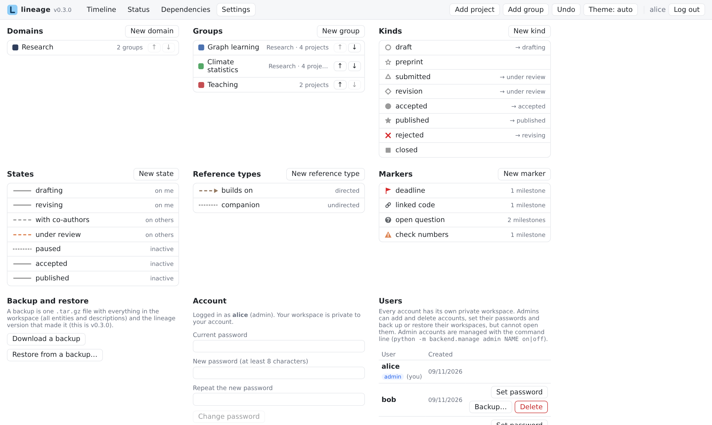

# Vocabulary

**Settings** holds the words lineage draws with. All of it is yours to change; nothing in lineage depends on particular names.

<figure markdown="span">
  
  <figcaption>Settings: domains, groups, kinds, states, reference types and markers.</figcaption>
</figure>

| Entity | What it controls |
|---|---|
| **Domains** | optional top-level areas; groups belong to one or none, and are drawn under it |
| **Groups** | sets of projects drawn together, each with a colour |
| **Kinds** | a milestone's type: its symbol shape and size, an optional default state, and whether it **closes** the project |
| **States** | the condition between two milestones: line pattern, colour, thickness, opacity, default line text, and who the project is **waiting on** (me, others, nobody) |
| **Reference types** | how references look (pattern, colour, thickness, opacity) and whether they are **directed** (drawn with an arrow) |
| **Markers** | flags on milestones, each with an icon (warning, question, chain, flag, pin, clock, lock, check, info) and a colour |

Groups and domains can be reordered in Settings. Ids are made from the name when something is created and never change afterwards, so renaming is always safe.

**Settings → Fork and merge lines** sets the colour and thickness of fork and merge lines.

## The starter vocabulary

A new account (other than the showcase accounts) starts with a vocabulary for papers:

- **Kinds:** draft, preprint, submitted, revision, accepted, published, rejected, closed (closed ends the project).
- **States:** drafting and revising (waiting on me); with co-authors and under review (waiting on others); paused, accepted and published (waiting on nobody).
- **Reference types:** builds on (directed), companion (undirected).

## Choices available

- **Symbol shapes:** open and filled circle, diamond, square, triangle, star and arrows, and a cross.
- **Line patterns:** solid, dashed, dotted, long dash, dash-dot, dash-dot-dot.
- **Colours** are `#RRGGBB`. Kinds, states, reference types and markers can leave theirs unset to use the theme's neutral colour, which adapts to dark mode.

The exact ranges (sizes, thicknesses, text sizes) are listed in the [data format](../reference/data-format.md).

## Another vocabulary: GitHub

The **lineage** showcase account describes a code repository instead. Its vocabulary shows how far the same model goes:

- **Projects** are branches (`main`, `feature/accounts`, `docs/site`…), in groups *main*, *feature branches*, *docs branches* and *issues*, under a domain named after the repository.
- **Kinds:** *commit*, *pull request*, *merge* (a merge commit on the target branch, which merges the pull request), *release* (a tag), *issue*, and *closed* (closed without merging).
- **States:** *in progress* (on me), *in review* (on others), *under discussion* (an open issue), *merged* (inactive).
- **Reference types:** *depends on* (directed) and *related*. **Markers:** *open question*, *bug*, *blocked*, *breaking change*.
