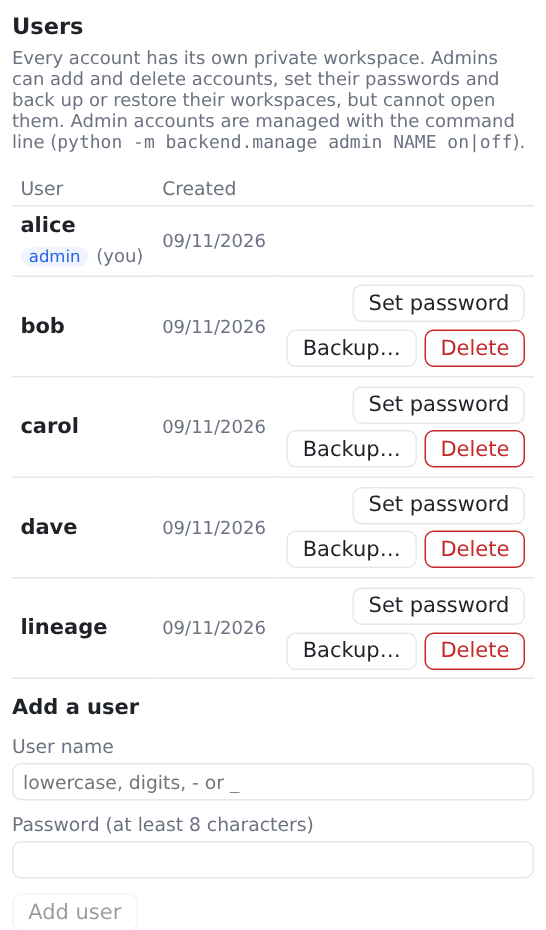
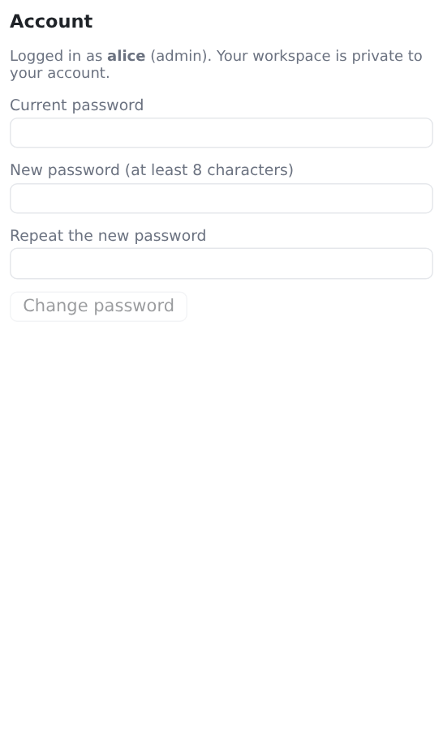

# Accounts

Every user logs in, and every account has its own **private workspace** in `data/users/<name>/`. Users cannot see or change each other's data; undo, hand edits, backups and restores only ever touch the user's own folder.

There is no sign-up page. Accounts are managed by **admins** in the web page (**Settings → Users**), or by whoever runs the server, from the [command line](../reference/cli.md).

## Admin accounts

An admin is an ordinary account with a private workspace of its own, plus a **Users** section in **Settings**, from which it can:

- **add** a user (name and password);
- **set the password** of a user (which logs that user out everywhere);
- **delete** a user, keeping their workspace folder on the server or deleting it too;
- **download a backup** of a user's workspace, or **restore** one into it. The user can undo such a restore with **Undo**, like one of their own.

<figure markdown="span">
  [{ width="420" }](../assets/screenshots/users.png)
  <figcaption>Settings → Users, as seen by an admin: plain accounts can be managed; admin accounts are only listed.</figcaption>
</figure>

An admin **cannot open** another user's workspace in the app, and can only manage **non-admin** accounts from the web page. Admin accounts — including making someone an admin or taking it away — are managed with the command line, so that one admin cannot lock out or take over another.

**Who is admin:**

- The **first account created** while there is no admin becomes one automatically, whether made with `manage adduser` or otherwise. The showcase accounts (demo, lineage) never do.
- More admins: `manage adduser NAME --admin`, or `manage admin NAME on` for an existing account; `manage admin NAME off` makes it a plain user again. Changes apply immediately, also to sessions already open.
- `manage list` marks admins with `(admin)`. If no admin is left, the server log says so on start.

## Managing accounts

In Docker, prefix each command with `docker compose exec -it lineage`. From source, set `DATA_DIR` and use `.venv/bin/python`:

```sh
python -m backend.manage list                       # list the accounts; admins are marked
python -m backend.manage adduser NAME               # asks for a password (at least 8 characters)
python -m backend.manage adduser NAME --admin       # … as an admin
python -m backend.manage admin NAME on|off          # make an account an admin, or a plain user again
python -m backend.manage adduser NAME --from DIR    # start from a copy of a data folder, e.g. examples/papers
python -m backend.manage adduser NAME --adopt       # take over a pre-0.2 single-user workspace
python -m backend.manage passwd NAME                # set a password; logs that user out everywhere
python -m backend.manage deluser NAME               # delete an account; its workspace folder stays
python -m backend.manage deluser NAME --purge       # … and delete its workspace too
```

- `--password-stdin` reads the password from the first line of standard input instead of asking, for scripts.
- The running server picks up changes right away; there is no need to restart it.
- **User names** are 1 to 32 characters: lowercase letters, digits, `-` and `_`, starting with a letter or digit.
- A **new account** starts with the [starter vocabulary](../guide/vocabulary.md#the-starter-vocabulary) and no projects, unless created with `--from` or `--adopt`.
- If you delete an account without `--purge` and later create one with the same name, it gets the old workspace back.

## Changing your own password

Any user can change their password in **Settings → Account**. Their other sessions (other browsers, other devices) are logged out; the current one stays logged in.

<figure markdown="span">
  [{ width="420" }](../assets/screenshots/account.png)
  <figcaption>Settings → Account.</figcaption>
</figure>

## Sessions

Logging in sets a cookie that keeps you logged in for **30 days**, or until you press **Log out**. Changing a password — from Settings or with `manage passwd` — and deleting the account end every session of that user.

After **5 failed logins** for the same user from the same address, further attempts are refused for 30 seconds, then 60, 120 and so on (up to an hour). A successful login resets the count.

## The default admin

Whenever lineage starts and finds **no admin account** — on a fresh install, or after the last admin was removed — it creates the account **admin** with the password **admin**, as an admin, with an empty workspace (if the name `admin` is taken by a plain user, it does not, and the log says how to make an admin).

- Log in as admin/admin: lineage shows only a **Choose a new password** screen, and refuses everything else (also through the API) until a new password of at least 8 characters is set.
- `manage passwd admin` sets it from the command line instead.
- While admin still has the password `admin`, the server log warns on every start.

## The demo account

On the **first start** — when `data/accounts.yaml` does not exist yet — lineage creates two showcase accounts, so you can look around right away:

| Account | Password | Workspace |
|---|---|---|
| **demo** | `demo` | fictional research papers and teaching projects (`examples/papers`) |
| **lineage** | `lineage` | lineage's own development, in GitHub words: branches, commits, pull requests, merges and releases, with their real times (`examples/lineage`) |

- They are created only once. If you delete one, it stays deleted.
- To skip them entirely, start the first time with `LINEAGE_DEMO=0`. lineage then starts with no accounts, and logs a reminder to create one.
- While a showcase account still has its public password, the server log warns about it on every start.
- They are never made admins automatically, and `manage admin NAME on` is refused for them while they have their public password.

!!! warning
    Before you make lineage reachable from other machines, delete the showcase accounts (`manage deluser demo --purge`, `manage deluser lineage --purge`) or give them real passwords (`manage passwd …`).

## Forgotten passwords

There is no password reset by email. An admin sets a new one in **Settings → Users**; for an admin account, whoever runs the server does it with `manage passwd NAME`.
